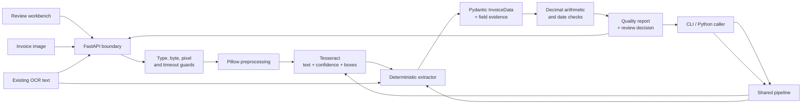

# LedgerLens

**Explainable invoice intelligence for workflows that need evidence, not just extracted text.**

[](https://www.python.org/)
[](https://fastapi.tiangolo.com/)
[](https://github.com/aelsaeed/LedgerLens/actions/workflows/ci.yml)
[](https://peps.python.org/pep-0561/)
[](#license)

LedgerLens turns invoice images—or text from an existing OCR provider—into normalized,
audit-ready JSON. It preserves the source line and bounding box behind each extracted value,
reconciles invoice arithmetic with exact decimal math, and returns an explicit **ready to
automate / review required** decision.

The project is deliberately local-first and deterministic. It demonstrates a complete document
processing slice: a polished review workbench, versioned FastAPI endpoints, a batch-friendly CLI,
typed domain models, defensive upload handling, OCR integration, and automated quality gates.

> **Try it locally:** the built-in demo needs no invoice file or Tesseract binary. There is no
> hosted demo at present.

## What it demonstrates

| Product need | LedgerLens response |
| --- | --- |
| Operators need to verify extracted values | Field-level evidence includes the source line, extraction method, OCR confidence, and pixel coordinates when OCR is used. |
| Finance data must not drift through floating-point math | Monetary values use `Decimal`; line items, subtotal, total, discount, tax, and date order are checked deterministically. |
| Uncertain documents should not silently enter automation | A transparent quality score, missing-field report, warnings, and hard review-routing rules accompany every result. |
| Integrators need more than one entry point | The same pipeline powers a browser workbench, REST API, Python package, and CLI. |
| Uploaded documents need bounded processing | Media types, upload bytes, decoded pixels, and OCR runtime are limited; temporary files are removed after each request. |

### Current features

- OCR through Tesseract with grayscale conversion, EXIF correction, autocontrast, line confidence,
  and bounding-box capture.
- Typed extraction for vendor, invoice number, invoice and due dates, line items, subtotal, tax,
  discount, total, and currency.
- US and common international number formats, several unambiguous date formats, and explicit
  warnings for ambiguous numeric dates or `$` currency inference.
- Four deterministic audit checks: line-item arithmetic, subtotal reconciliation, grand-total
  reconciliation, and due-date ordering.
- Responsive, keyboard-accessible review UI with drag-and-drop upload, evidence drill-down,
  bounding-box highlighting on the source image, audit status, and copyable JSON.
- Versioned API plus interactive OpenAPI and ReDoc documentation.
- Single- and multi-file CLI scanning, external-OCR text ingestion, and a deterministic demo.
- Configurable upload, image, timeout, language, and raw-text exposure policies.

## Quickstart

LedgerLens requires Python 3.10 or newer. Image scanning also requires the Tesseract executable;
the text and demo paths do not.

```bash
git clone https://github.com/aelsaeed/LedgerLens.git
cd LedgerLens

python -m venv .venv
source .venv/bin/activate       # Windows PowerShell: .venv\Scripts\Activate.ps1
python -m pip install --upgrade pip
pip install -e ".[dev]"
```

Install Tesseract if you want to scan images:

```bash
# Ubuntu / Debian
sudo apt-get update && sudo apt-get install -y tesseract-ocr

# macOS
brew install tesseract
```

### 1. Explore the demo

Start the application:

```bash
uvicorn invoice_scanner.api:app --reload
```

Then open [http://localhost:8000](http://localhost:8000). The workbench loads a deterministic,
pre-audited sample automatically; choose **Scan an invoice** to exercise the OCR path. API schemas
are available at [http://localhost:8000/docs](http://localhost:8000/docs) and
[http://localhost:8000/redoc](http://localhost:8000/redoc).

For a terminal-only demo:

```bash
ledgerlens demo
```

### 2. Use the CLI

```bash
# Generate a simple local fixture, then OCR it
python scripts/generate_sample_invoice.py
ledgerlens scan data/sample_invoice.png

# Batch mode returns a JSON array
ledgerlens scan invoice-a.png invoice-b.jpg

# Preserve raw OCR text when needed (redacted by default for `scan`)
ledgerlens scan --include-raw-text invoice-a.png

# Skip local OCR and audit text produced elsewhere
ledgerlens extract-text ocr-output.txt
```

`invoice-scanner` remains available as an alias for `ledgerlens`.

### 3. Call the API

Get a deterministic response without OCR:

```bash
curl http://localhost:8000/api/v1/demo
```

Submit text from another OCR system:

```bash
curl -X POST http://localhost:8000/api/v1/extract \
  -H 'Content-Type: application/json' \
  -d '{
    "source_name": "invoice-1042.txt",
    "text": "Northstar Cloud Ltd\nInvoice Number: LL-2026-1042\nInvoice Date: 2026-08-18\nSubtotal 477.00\nTax 47.70\nTotal USD 524.70"
  }'
```

Scan an image:

```bash
curl -X POST http://localhost:8000/api/v1/scan \
  -F 'file=@data/sample_invoice.png'
```

Useful routes:

| Method | Route | Purpose |
| --- | --- | --- |
| `GET` | `/` | Interactive invoice review workbench |
| `GET` | `/api/v1/health` | Service and Tesseract availability |
| `GET` | `/api/v1/demo` | Deterministic, OCR-free sample |
| `POST` | `/api/v1/extract` | Normalize and audit supplied OCR text |
| `POST` | `/api/v1/scan` | OCR, normalize, and audit an image |

PNG, JPEG, TIFF, WebP, and BMP uploads are accepted. The default upload limit is 10 MiB and the
default decoded-image limit is 25 million pixels.

### 4. Run with Docker

The container includes the Tesseract runtime, so image scanning works without a host install.

```bash
docker build -t ledgerlens .
docker run --rm -p 8000:8000 ledgerlens
```

Open [http://localhost:8000](http://localhost:8000), or verify the service:

```bash
curl http://localhost:8000/api/v1/health
```

## Example response

This is a selected, valid JSON slice from `ledgerlens demo`. Decimal values intentionally remain
strings at the JSON boundary so their precision is preserved.

```json
{
  "vendor_name": "Northstar Cloud Ltd",
  "invoice_number": "LL-2026-1042",
  "invoice_date": "2026-08-18",
  "due_date": "2026-09-17",
  "subtotal": "477.00",
  "tax_amount": "47.70",
  "total_amount": "524.70",
  "currency": "USD",
  "quality": {
    "score": 100,
    "review_required": false,
    "missing_fields": [],
    "warnings": [],
    "checks": [
      {
        "code": "TOTAL_RECONCILED",
        "status": "pass",
        "message": "Grand total versus subtotal, tax, and discount reconciles within 0.01.",
        "expected": "524.70",
        "actual": "524.70",
        "delta": "0.00"
      }
    ],
    "evidence": {
      "total_amount": {
        "source_text": "Total USD 524.70",
        "method": "label",
        "confidence": null,
        "bounding_box": null
      }
    }
  }
}
```

The demo follows the supplied-text path, so OCR confidence and bounding boxes are `null`. Image
scans populate them when Tesseract returns positional data.

## Architecture



The API moves blocking OCR work to Starlette's thread pool. Both image and supplied-text flows
converge on the same extraction, schema, and audit layers, keeping behavior consistent across the
web UI, API, and CLI.

## Trust model

LedgerLens treats extraction and approval as different concerns. A value can be extracted while
the document is still routed to a person for review.

### Evidence

Each supported field can point back to:

- the normalized source line;
- the method used (`label`, `layout`, `table_row`, `currency_code`, or `currency_symbol`);
- OCR confidence, when available; and
- the line's pixel bounding box, which the workbench highlights on the uploaded image.

### Deterministic checks

Money is parsed into `Decimal` and rounded to cents with `ROUND_HALF_UP`. Reconciliations allow a
one-cent tolerance. Checks return `pass`, `warning`, or `skipped`; skipped means there was not
enough extracted data to evaluate that rule, not that the invoice passed it.

### Quality score and review routing

The score is an explainable workflow heuristic—not a probability, model confidence, fraud score,
or accounting approval.

1. Completeness contributes up to 100 points: vendor 15, invoice number 15, invoice date 10, due
   date 5, subtotal 5, total 25, currency 10, and line items 15.
2. For image scans with evidence confidence, the score blends 70% completeness with 30% mean OCR
   confidence.
3. Each failed audit check subtracts 15 points; each extraction warning subtracts 5.
4. The rounded result is clamped to 0–100.

Review is required whenever a core field (vendor, invoice number, invoice date, total, or currency)
is missing, any audit check warns, an extraction warning exists, or the final score is below 75.
This makes the routing rule stricter than the headline score alone.

## Configuration

Settings are read from environment variables or a local `.env` file.

| Variable | Default | Meaning |
| --- | ---: | --- |
| `LEDGERLENS_OCR_LANG` | `eng` | Tesseract language pack |
| `LEDGERLENS_OCR_TIMEOUT_SECONDS` | `15` | Per-image OCR deadline (1–120 seconds) |
| `LEDGERLENS_MAX_UPLOAD_BYTES` | `10485760` | Maximum compressed upload size |
| `LEDGERLENS_MAX_IMAGE_PIXELS` | `25000000` | Maximum decoded pixel count |
| `LEDGERLENS_EXPOSE_RAW_TEXT` | `true` | Deployment-level permission to expose source text |

For a privacy-oriented API deployment:

```bash
LEDGERLENS_EXPOSE_RAW_TEXT=false uvicorn invoice_scanner.api:app
```

`POST /api/v1/scan` and `POST /api/v1/extract` redact `raw_text` by default. A caller can request it
with `?include_raw_text=true` only while `LEDGERLENS_EXPOSE_RAW_TEXT=true`; setting the environment
variable to `false` is the deployment-wide veto. The Docker Compose profile uses that safer value
by default.

## Privacy and security boundaries

- The service has no database, cloud OCR call, analytics client, or document-retention feature.
- API uploads are read under a fixed byte limit, written to an operating-system temporary file,
  processed locally, and unlinked in a `finally` block after the request.
- The API accepts only declared image media types, then Pillow verifies the actual file is a
  readable image and enforces the decoded-pixel ceiling.
- Uploaded filenames are reduced to their basename before being returned as metadata.
- Raw OCR text can contain personal or financial information. Image and text API routes require
  the explicit `?include_raw_text=true` query parameter, subject to the deployment-wide setting.
  CLI image scans likewise omit it unless `--include-raw-text` is passed.

This repository is an application foundation, not a hardened multi-tenant service. A public
deployment still needs TLS, authentication and authorization, rate limiting, request-level
observability, dependency scanning, and a deliberate retention policy. A forced process or host
failure could also interrupt temporary-file cleanup, so production operators should manage the
temporary directory accordingly.

## Tests and quality gates

Install the development dependencies, then run:

```bash
pytest
ruff check .
ruff format --check .
python -m build
```

The current suite completes with **102 passing tests and 99.30% branch coverage**. Pytest enforces
an 85% project threshold and exercises the
extraction and audit rules, OCR failure boundaries, pipeline redaction behavior, API upload and
error contracts, and CLI output. Continuous integration runs linting, tests on Python 3.10–3.12,
and package builds. No extraction-accuracy claim is made without a representative, labeled
invoice corpus.

## Design trade-offs

| Decision | Benefit | Cost / next pressure point |
| --- | --- | --- |
| Deterministic extraction instead of an LLM | Repeatable, offline, inexpensive, and easy to explain | Less tolerant of novel layouts and languages; rules need deliberate extension |
| Remove the four-sample PyTorch classifier | Unknown vendors no longer receive arbitrary labels presented as confidence | ML returns only after a licensed dataset, meaningful target, held-out evaluation, and abstention policy exist |
| `Decimal` instead of binary floats | Predictable financial arithmetic | Values serialize as JSON strings and consumers must preserve decimal semantics |
| Line-level bounding-box evidence | Compact provenance that supports visual source highlighting today | Token-level coordinates would isolate individual values more precisely |
| Synchronous request flow with a thread pool | Small deployment surface and simple local demo | Long-running or high-volume workloads need a queue, workers, and idempotency |
| No persistence | Minimizes retained sensitive data | There is no review history, corrections store, or audit-log durability |
| Vanilla HTML, CSS, and JavaScript | Fast load, no frontend build chain, deploys with the API | A larger product would benefit from a component and end-to-end test strategy |
| Transparent weighted score | Operators can inspect and tune every rule | It is not empirically calibrated until evaluated against labeled workflow outcomes |

The classifier decision is recorded in
[ADR 001](docs/adr-001-remove-unvalidated-classifier.md). The prototype had four training rows,
three opaque labels, and no held-out evaluation; an unseen vendor produced an all-zero input but
still received a softmax label. Removing it from the request path was a model-risk decision, not a
claim that deterministic rules solve every classification problem.

## Known limitations

- Image input only; PDFs and multipage document workflows are not yet supported.
- Extraction labels and heuristics are currently English-oriented even though Tesseract language
  packs are configurable.
- Table extraction targets common `description / quantity / unit price / total` layouts and does
  not attempt arbitrary table reconstruction.
- Numeric dates that can mean either day-first or month-first are interpreted month-first and
  flagged for review. A bare dollar symbol is treated as USD and also flagged.
- OCR quality depends on the source image and installed Tesseract language data.
- There is no trained fraud model, vendor master-data lookup, duplicate detection, or tax-policy
  validation.

## Roadmap

- PDF and multipage ingestion with per-page provenance.
- Pluggable OCR adapters and stronger multilingual extraction.
- A versioned, labeled evaluation corpus with per-field precision/recall and regression reports.
- Configurable schemas, locale rules, and organization-specific review policies.
- Async workers, idempotency keys, authentication, rate limiting, and durable audit events for a
  production deployment.

## How to discuss this project

Useful CV or interview talking points—kept specific to what the repository demonstrates:

- Built an end-to-end document-intelligence service spanning local OCR, typed extraction,
  exact-money validation, REST/CLI interfaces, and an interactive review workflow.
- Designed explainability into the response contract with source evidence, OCR confidence,
  bounding boxes, deterministic checks, and explicit human-review routing.
- Hardened the ingestion boundary with content and pixel limits, OCR deadlines, structured error
  mapping, temporary-file cleanup, and configurable sensitive-text redaction.
- Chose auditable rules over opaque model output for the first version, then defined a measurable
  path toward broader layout coverage and calibrated evaluation.

The strongest engineering discussion is the boundary between **extraction confidence** and
**business authorization**: LedgerLens can help decide what needs attention, but it never presents
its heuristic score as permission to pay an invoice.

## Project structure

```text
.
├── src/invoice_scanner/
│   ├── api.py          # HTTP boundary, dashboard, uploads, error mapping
│   ├── audit.py        # deterministic checks and review score
│   ├── cli.py          # single, batch, text, and demo commands
│   ├── config.py       # environment-backed policy
│   ├── extraction.py   # parsing and evidence capture
│   ├── ocr.py          # image safety, preprocessing, Tesseract adapter
│   ├── pipeline.py     # image/text orchestration
│   ├── sample.py       # deterministic demo fixture
│   ├── schema.py       # public Pydantic models
│   └── static/         # accessible review workbench
├── scripts/            # sample invoice generator
├── docs/               # architectural decision records
├── tests/              # unit, API, pipeline, and CLI tests
├── Dockerfile
└── pyproject.toml
```

## License

Released under the [MIT License](LICENSE).
